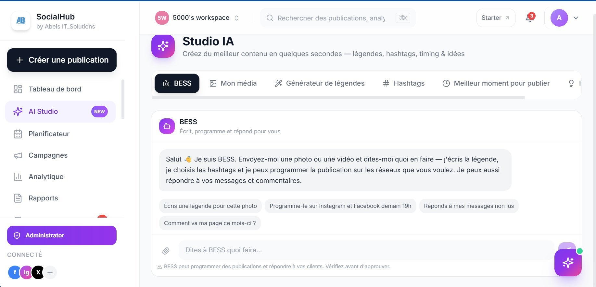
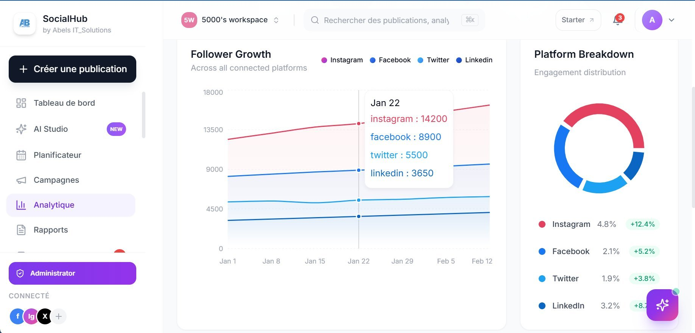
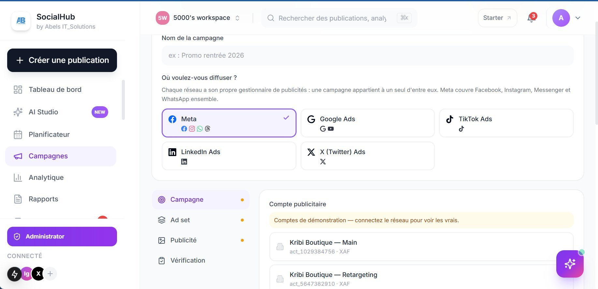

# SocialHub

**Social media scheduling with an AI assistant built in — one app, one plan.**

SocialHub is a scheduling tool for creators and small businesses to plan, upload, and publish short videos from one calm dashboard — including to TikTok — without paying for a separate scheduler and a separate AI tool.

> **Status:** In development, pre-launch. This repository is a showcase only.
> The SocialHub source code is private and is not shared here.

## What it does

- **Smart scheduling** — Plan days or weeks of content in one sitting. Videos go out at the right hour, even while you sleep.
- **TikTok publishing** — Connect a TikTok account securely and publish directly, or send videos to drafts for a final review.
- **Clear analytics** — See views, likes, comments, and shares per video, so you know what your audience actually loves.
- **Built-in AI assistant** — AI help directly inside the scheduler, instead of switching between a scheduler subscription and a separate AI subscription.
- **Made for creators and SMEs** — Built with small businesses and creators in mind, starting in Cameroon.

## Who it is for

- Creators posting short videos regularly
- Small businesses that want consistent social media without a full marketing team
- Teams that want scheduling, publishing, and analytics in one place

## Screenshots

*Dashboard — brand health score and totals at a glance.*

*AI Studio — BESS, the built-in assistant that writes captions, picks hashtags, and schedules.*

*Analytics — follower growth across Instagram, Facebook, Twitter, and LinkedIn, plus platform breakdown.*

*Campaigns — ad setup across Meta, Google Ads, TikTok Ads, LinkedIn Ads, and X Ads.*

## Showcase only — no source code

This repository contains no application source code, no API keys, and no credentials. Please do not open issues asking for the source code — it is a private commercial product.

If you want to follow the launch, follow the builder on LinkedIn.

## About the builder

Built by **Yemeli Juiazong Abel Cedrique** — Web & Mobile Developer, Yaoundé, Cameroon.

- LinkedIn: https://www.linkedin.com/in/yemeli-abel-256065171
- Other public work: https://github.com/Yemeli/tchop
